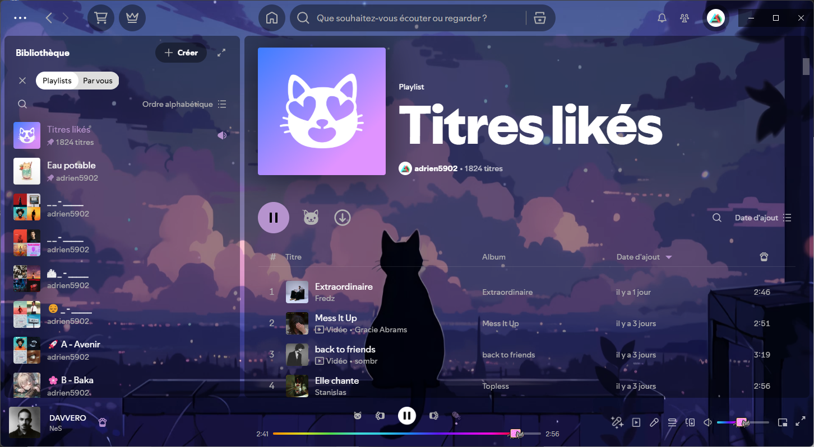
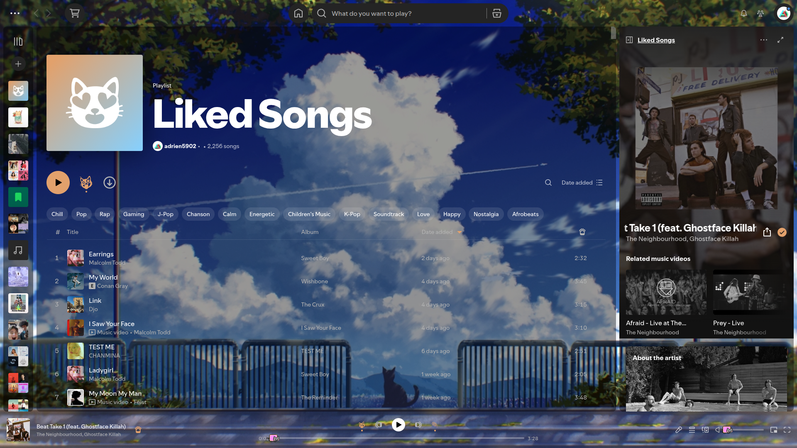
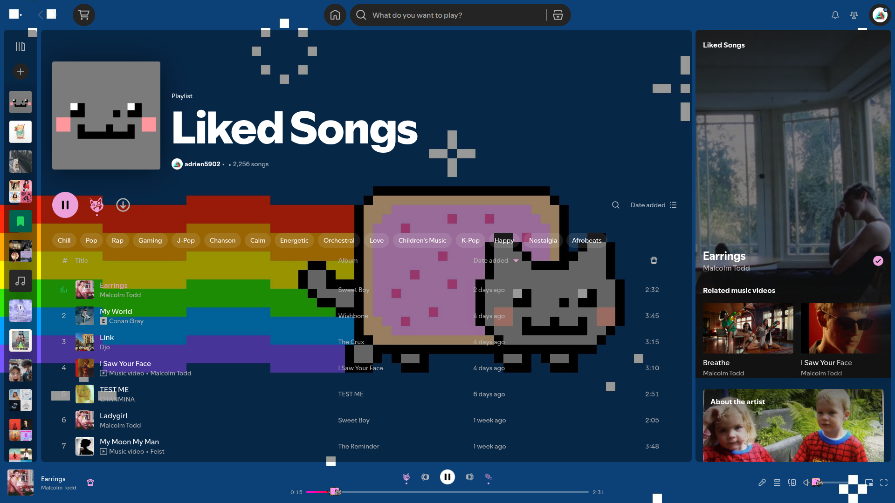
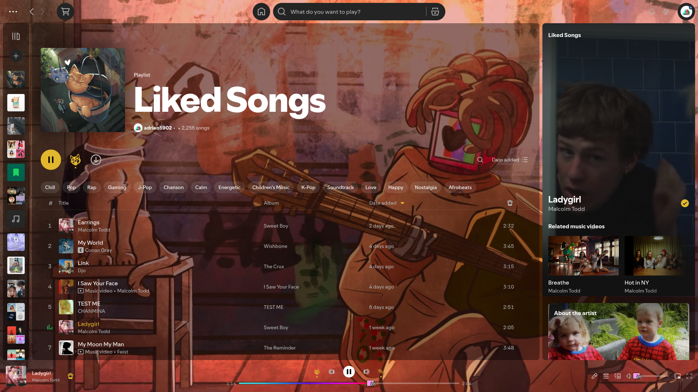

# 🐱 SpicetifyCat — Custom Wallpaper, Gradient & Solid Themes for Spotify

A customizable [Spicetify](https://spicetify.app/) theme featuring custom cat & anime wallpapers, eye-friendly dark gradients, solid color modes, Nyan Cat progress/volume bars with matching per-theme gradients, and custom cat-paw player icons.

> **Preview (Classic Sub-Themes):**
> |  |  |
> | :---: | :---: |
> |  |  |

---

## ✨ Features

- **17 Built-in Sub-Themes:**
  - **6 Anime Wallpaper Themes:** `Reze_Neon`, `Power_Cat`, `Reze_Pool`, `Reze_Daylight`, `Anime_1`, `Anime_2`
  - **5 Classic Cat Wallpaper Themes:** `Purple`, `Summer_Sky`, `NyanCat`, `Stray`, `Love_is_War`
  - **4 Eye-Friendly Dark Gradients:** `Aurora_Gradient`, `Nyan_Gradient`, `Sunset_Gradient`, `Ocean_Gradient`
  - **2 Solid Dark Themes:** `Midnight_Solid`, `Rose_Solid`
- **Cohesive Per-Theme Palettes:** Every sub-theme automatically adapts the background, dim/blur overlay, timeline & volume bar gradients, play/pause button, search bar accents, scrollbars, and lyrics preview border.
- **3 Easy Ways to Switch Themes:**
  1. **One-Click Batch Script (`theme.conf` + `apply-theme.bat`)** on Windows
  2. **In-App Spotify Menu** (Profile Avatar → **Cat Theme**)
  3. **Spicetify CLI** (`spicetify config color_scheme <THEME_NAME>`)

---

## 🚀 Quick Installation & Theme Switching (Windows)

1. Make sure [Spicetify](https://spicetify.app/docs/getting-started) is installed.
2. Download or clone this repository anywhere on your computer.
3. Open **`theme.conf`** in any text editor (e.g., Notepad) and change the `THEME` field to the theme you want:
   ```ini
   THEME = Reze_Neon
   ```
   *(All available theme names are listed inside `theme.conf`.)*
4. Double-click **`apply-theme.bat`**.
   - It automatically copies the theme and local wallpapers into `%appdata%\spicetify\Themes\SpicetifyCat`, enables the required Spicetify flags (`overwrite_assets`, `inject_css`, `inject_theme_js`), sets your chosen `color_scheme`, and runs `spicetify apply`.

---

## 🔄 How to Change Themes Anytime

### Option 1: Using `theme.conf` + `apply-theme.bat` (Recommended)
1. Open `theme.conf` and edit `THEME = Your_Choice`.
2. Double-click `apply-theme.bat`.

### Option 2: Inside Spotify (Instant Preview)
1. Click your **Profile Avatar** in the top-right corner of Spotify.
2. Hover over **Cat Theme** in the dropdown menu.
3. Click any theme name to switch backgrounds, dim/blur, accent controls, and bar gradients immediately without restarting Spotify!
   - *(Select **Auto (use Spicetify color_scheme)** to return control to `theme.conf` / CLI.)*

### Option 3: Manual CLI Installation & Switching (Windows / Linux / macOS)
1. Copy this repository folder into your Spicetify `Themes` directory and name the folder `SpicetifyCat`:
   - **Windows:** `%appdata%\spicetify\Themes\SpicetifyCat`
   - **Linux / macOS:** `~/.config/spicetify/Themes/SpicetifyCat`
2. Run the following commands in your terminal:
   ```bash
   spicetify config current_theme SpicetifyCat
   spicetify config color_scheme Reze_Neon
   spicetify config inject_css 1 replace_colors 1 overwrite_assets 1 inject_theme_js 1
   spicetify apply
   ```
3. To switch sub-themes later via terminal:
   ```bash
   spicetify config color_scheme <THEME_NAME>
   spicetify apply
   ```

---

## 🎨 Available Sub-Themes

| Theme Name | Style | Description |
| :--- | :--- | :--- |
| `Reze_Neon` | Wallpaper | Reze close-up with spiral emerald green eye & violet/pink neon bar |
| `Power_Cat` | Wallpaper | Power holding Meowy with deep crimson & coral accents |
| `Reze_Pool` | Wallpaper | Reze in the pool at night with ocean blue & aqua teal accents |
| `Reze_Daylight` | Wallpaper | Reze with yellow daisies & blue sky, warm sunflower gold accents |
| `Anime_1` | Wallpaper | Dark gray-green portrait with glowing crimson eye |
| `Anime_2` | Wallpaper | Dark occult portrait with glowing rose-red halo & subtle panel blur |
| `Purple` | Wallpaper | Default cat silhouette overlooking a purple night sky |
| `Summer_Sky` | Wallpaper | Cat overlooking bright summer clouds (art by [Aeuna](https://www.pixiv.net/en/artworks/96275146)) |
| `NyanCat` | Wallpaper | Pixel-art Nyan Cat in space with classic rainbow bar (by [@linnymenta](https://github.com/linnymenta)) |
| `Stray` | Wallpaper | Stray & Momo playing guitar with warm amber accents |
| `Love_is_War` | Wallpaper | Hatsune Miku teal & magenta theme (by [@GabbaDev](https://github.com/GabbaDev)) |
| `Aurora_Gradient` | Gradient | Eye-friendly dark teal-to-violet aurora gradient |
| `Nyan_Gradient` | Gradient | Deep space navy-to-purple gradient with Nyan rainbow bar |
| `Sunset_Gradient` | Gradient | Dark dusk purple-to-warm-rose gradient |
| `Ocean_Gradient` | Gradient | Deep abyssal navy-to-teal gradient |
| `Midnight_Solid` | Solid | Ultra-dark `#0f1117` slate background with lavender accents |
| `Rose_Solid` | Solid | Deep `#1f0d17` burgundy background with rose pink accents |

---

## 🛠️ Adding Your Own Custom Theme or Wallpaper

1. **Drop your wallpaper** (1920×1080 `.jpg` or `.png` recommended) into `assets/backgrounds/My_Theme.jpg`.
2. **Add an entry in `theme.js`** inside `CUSTOM_THEMES` (or `BUILTIN_THEMES`):
   ```js
   My_Theme: {
       image: "./backgrounds/My_Theme.jpg", // or use `background: "linear-gradient(...)"`
       dim: 0.35,                           // 0..1 black overlay to keep panels readable
       blur: 0,                             // panel backdrop blur in px
       accent: "#2ee59d",                   // main accent color
       accentLight: "#7bfac4",              // hover / highlight accent color
       bar: "linear-gradient(90deg,#1a4b8c 0%,#2ee59d 70%,#7bfac4 100%)",
       likedSongs: "Purple",                // folder under themes/ for Liked Songs cover
   },
   ```
3. **Add a matching `[My_Theme]` section in `color.ini`** (copy any existing section and swap `button`, `button-active`, etc.).
4. Set `THEME = My_Theme` in `theme.conf` and run `apply-theme.bat`!
